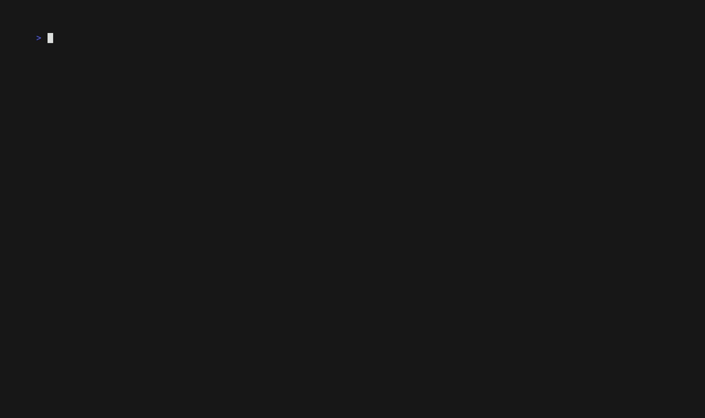

# Boardwalk

**Your GitHub Projects boards, in the terminal.**

Boardwalk lets you read and update GitHub Projects (Projects v2) boards without opening a browser. Check what is in flight, move cards, fix a title, file a draft — all from your shell, at keyboard speed. It works through the GitHub CLI (`gh`) session you already have, and never sees or stores your token.



## Install

1. Download the binary for your system from the [releases page](https://github.com/juanrubio/boardwalk/releases), and check it against `SHA256SUMS` if you like.
2. Rename it to `boardwalk` and put it somewhere on your `PATH` (for example `~/.local/bin`).
3. Make sure the GitHub CLI is set up with the scopes Boardwalk needs:

```sh
gh auth login
gh auth refresh -s project,repo
```

That is the only setup. Boardwalk asks `gh` for access each time it runs and stores nothing itself.

Prefer building from source? With Go installed: `go build -o boardwalk ./cmd/boardwalk`.

**More than one GitHub account?** If `gh` holds several accounts (say a personal and an employer one) and the wrong one is active, leave it alone and tell Boardwalk which to use:

```sh
boardwalk --account juanrubio board
BOARDWALK_ACCOUNT=juanrubio boardwalk item list
```

Boardwalk borrows that account's token from `gh` for the run and checks its scopes the same way; `gh`'s active account is never switched. Each account needs the one-time setup above (`gh auth login`, then `gh auth refresh -s project,repo` while that account is active).

## Quick start

```sh
boardwalk project list                    # see your boards
boardwalk project use juanrubio/3         # pick the one you use most (optional alias: --as life)
boardwalk board                           # open it
```

Inside the board, everything is keyboard-driven and the footer always shows the keys that matter right now. Press `?` any time for the full list. The ones you will use most:

| Key | What it does |
|---|---|
| `↑↓←→` or `hjkl` | Move between cards and columns |
| `Enter` | Open an item (press again to close it) |
| `Tab` | Step into the detail pane to scroll a long description |
| `e` | Edit the item |
| `H` / `L` | Move the card to the previous / next column |
| `n` | New draft item |
| `a` | Add an existing issue or PR to the board |
| `C` | Turn a draft into a real issue |
| `D` | Delete an item permanently (asks twice — this cannot be undone) |
| `P` | Jump to another board |
| `[` / `]` | Previous / next board |
| `/` | Filter cards |
| `q` | Ask to quit from the board; Cancel is selected by default |

Boards open instantly from a local snapshot and refresh in the background, so you are never staring at a spinner. Column colours come from the colours you already gave your statuses on GitHub, and each board remembers how you left it — density, collapsed columns, grouping.

The status bar uses coloured shortcuts and distinct status messages. Detail fields and draft selectors retain GitHub's option colours; the projects picker and draft form make the current selection and editing focus visible in light, dark, and no-colour terminals. Confirming quit waits for pending moves; a failed move keeps the application open so its error can be read.

## From the command line

The same actions work as plain commands, which is handy in scripts:

```sh
boardwalk item list                                # what's on the board
boardwalk item move owner/repo#42 --to Done        # move a card
boardwalk item edit owner/repo#42 --field "Priority=P0"
boardwalk item add owner/repo#42                  # put an issue on the board
boardwalk item add --draft --title "Look into this" # or start as a draft
boardwalk item convert draft:91204910 --repo owner/repo  # draft → real issue
boardwalk item delete owner/repo#42               # permanent; asks twice
```

Every change first shows you a summary of exactly what will happen. Preview safely with `--dry-run`; in scripts, pass `--yes` to confirm (without it, a piped command that would change something refuses and exits with code 2). Add `--json` when a script needs to read the result.

## Good to know

- **Your boards stay yours.** Boardwalk only talks to GitHub's API with your own `gh` login. Board visibility is whatever you set on GitHub — personal boards are private unless you made them public.
- **Nothing is edited offline.** If a change fails, Boardwalk tells you which fields were saved and which were not, and never pretends otherwise.
- **It is fast on purpose.** Startup paints from a cached snapshot with zero network requests, and frame times are measured against fixed budgets in the test suite.

## Documentation and development

- [Product requirements](PRD.md) and the [CLI](docs/specs/cli.md) / [TUI](docs/specs/tui.md) specifications describe the exact behaviour; [architecture decisions](docs/decisions/) record why things are the way they are.
- [Roadmap](docs/roadmap.md) lists what's planned next, in build order, and what is deliberately not planned.
- [VHS tapes](tapes/) hold the scripted demos, including how the sanitized showcase above was recorded.
- Hacking on it: `make check` runs vet, the pinned linter, and the full offline test suite; `make build` builds the binary.

## License

[MIT](LICENSE) © Juan A. Rubio
